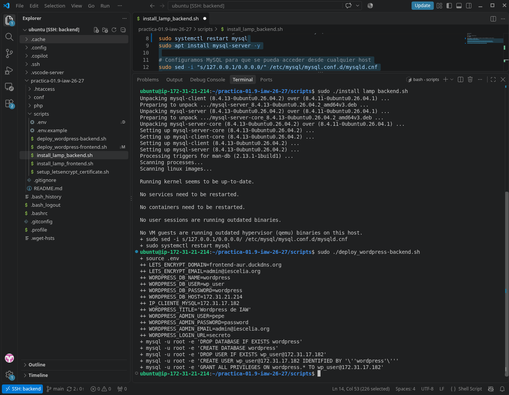
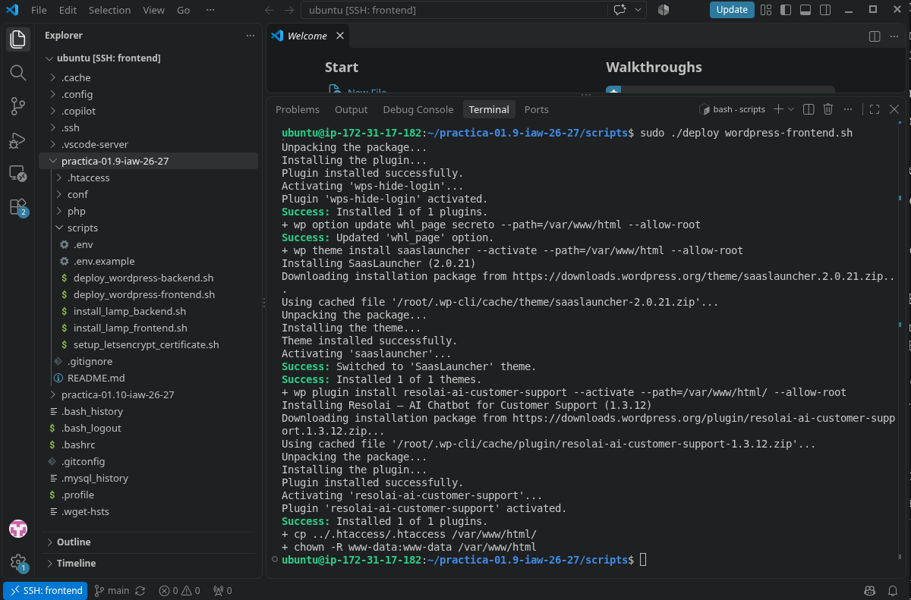
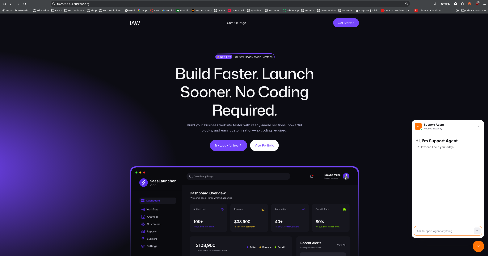
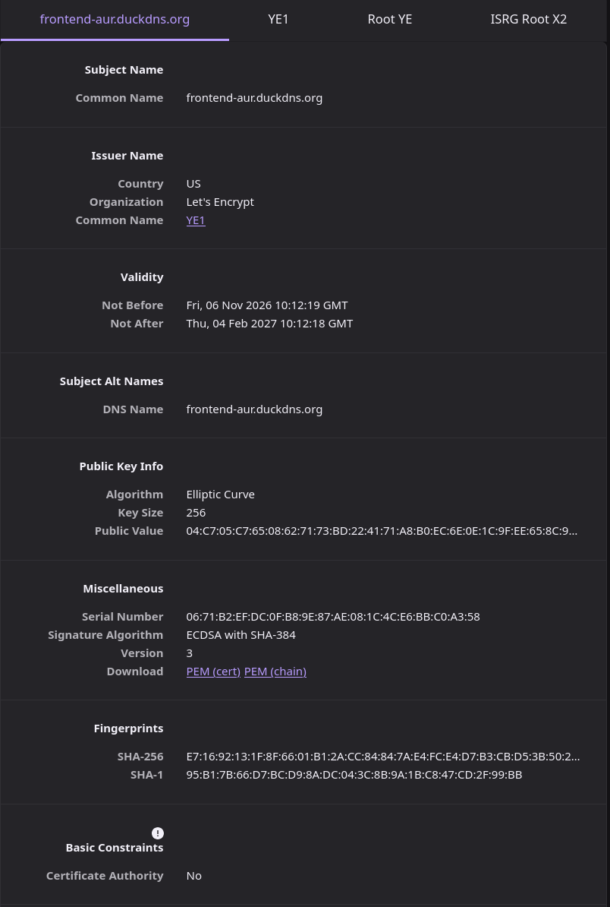
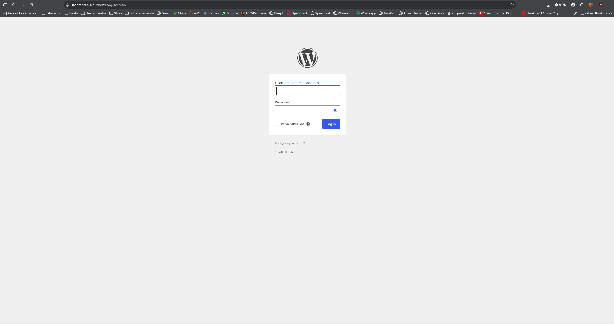

# Práctica 1.9: Arquitectura de una aplicación web LAMP en dos niveles

## Introducción y Objetivos

El objetivo de esta práctica es automatizar el despliegue de un sitio web **WordPress** sobre una **arquitectura LAMP en dos niveles**, repartiendo los servicios en **dos máquinas independientes**:

* **Frontend**: servidor web con **Apache** y **PHP**. Aquí se instala WordPress mediante **WP-CLI**, se emite el certificado SSL/TLS con **Let's Encrypt** y se atiende al usuario final.

* **Backend**: servidor de base de datos con **MySQL**. No es accesible desde Internet; únicamente recibe conexiones del frontend.

Esta separación mejora la seguridad (la base de datos no queda expuesta públicamente), facilita el escalado y es la base de arquitecturas más complejas (balanceadores, réplicas, etc.).

## Arquitectura

```
                  Internet
                     │
              80 (HTTP) / 443 (HTTPS)
                     │
          ┌──────────▼───────────┐
          │      FRONTEND        │
          │  Apache + PHP        │
          │  WordPress (WP-CLI)  │
          │  Certbot / SSL       │
          └──────────┬───────────┘
                     │  3306 (MySQL)
                     │  solo desde la IP del frontend
          ┌──────────▼───────────┐
          │       BACKEND        │
          │  MySQL Server        │
          └──────────────────────┘
```

## Requisitos Previos

Antes de ejecutar los scripts de automatización, se debe cumplir lo siguiente:

1. **Dos máquinas** con un sistema operativo basado en **Ubuntu** y acceso a privilegios de superusuario (`sudo`), una para el frontend y otra para el backend.

2. Un nombre de **dominio apuntando a la dirección IP pública del frontend**.

3. **Cortafuegos / grupos de seguridad** configurados así:

   | Máquina  | Puerto          | Origen                     |
   |----------|-----------------|----------------------------|
   | Frontend | 80 (HTTP)       | Cualquiera (`0.0.0.0/0`)   |
   | Frontend | 443 (HTTPS)     | Cualquiera (`0.0.0.0/0`)   |
   | Backend  | 3306 (MySQL)    | **Solo la IP del frontend** |

4. **Conectividad entre ambas máquinas**: el frontend debe poder alcanzar la IP del backend por el puerto 3306.

5. El repositorio clonado en **ambas máquinas**.

## Estructura del Repositorio

La arquitectura del proyecto está organizada de forma modular separando configuraciones, scripts de despliegue y archivos estáticos. Los scripts se dividen según la máquina en la que deben ejecutarse (`_frontend` / `_backend`):

```
.
├── conf/
│   ├── 000-default.conf                    # VirtualHost base para peticiones HTTP
│   └── virtualhost.conf.template           # Plantilla dinámica para el dominio con HTTPS/SSL
├── .gitignore                              # Exclusión de archivos sensibles (.env)
├── .htaccess/
│   └── .htaccess                           # Reglas de reescritura para permalinks
├── php/
│   └── index.php                           # Comprobación del motor PHP info
├── README.md                               # Documentación técnica del proyecto
├── screenshots/                            # Evidencias visuales del funcionamiento
│   ├── backend.png
│   ├── certificado.png
│   ├── script_backend.png
│   ├── script_frontend.png
│   ├── secreto.png
│   └── web.png
└── scripts/
    ├── .env.example                        # Plantilla de variables de entorno
    ├── install_lamp_backend.sh             # Paso 1 [BACKEND]:  Instalación de MySQL
    ├── install_lamp_frontend.sh            # Paso 2 [FRONTEND]: Instalación de Apache + PHP
    ├── setup_letsencrypt_certificate.sh    # Paso 3 [FRONTEND]: Configuración del SSL con Certbot
    ├── deploy_wordpress-backend.sh         # Paso 4 [BACKEND]:  Creación de la BD y el usuario de WordPress
    └── deploy_wordpress-frontend.sh        # Paso 5 [FRONTEND]: Despliegue automatizado con WP-CLI
```

## Resumen del Orden de Ejecución

El orden es importante: la base de datos debe existir **antes** de que WP-CLI intente instalar WordPress en el frontend.

| Paso | Máquina  | Script                             | Qué hace                                      |
|------|----------|------------------------------------|-----------------------------------------------|
| 0    | Ambas    | `.env`                             | Configuración de variables de entorno         |
| 1    | Backend  | `install_lamp_backend.sh`          | Instala MySQL y lo expone a la red            |
| 2    | Frontend | `install_lamp_frontend.sh`         | Instala Apache, PHP y módulos                 |
| 3    | Frontend | `setup_letsencrypt_certificate.sh` | VirtualHost definitivo + certificado SSL      |
| 4    | Backend  | `deploy_wordpress-backend.sh`      | Crea la base de datos y el usuario            |
| 5    | Frontend | `deploy_wordpress-frontend.sh`     | Instala WordPress con WP-CLI                  |

## Guía de Despliegue Paso a Paso

### Paso 0: Configuración de Variables de Entorno (en ambas máquinas)

Antes de lanzar la automatización, es imprescindible crear el archivo `.env` en la carpeta `scripts/` copiando la plantilla `.env.example`. Este archivo centraliza la configuración sensible para que los scripts no contengan contraseñas en duro. Está incluido en el `.gitignore`, por lo que nunca se sube al repositorio.

```
cd scripts/
cp .env.example .env
nano .env
```

Define los valores reales dentro de `.env`:

* `LETS_ENCRYPT_DOMAIN`: Tu dominio configurado (ej. `mi-dominio.com`).

* `LETS_ENCRYPT_EMAIL`: Tu correo de contacto para Let's Encrypt.

* `WORDPRESS_DB_NAME`, `WORDPRESS_DB_USER`, `WORDPRESS_DB_PASSWORD`: Credenciales de la base de datos de WordPress.

* `WORDPRESS_DB_HOST`: **IP privada del backend**. La utiliza el frontend para conectarse a MySQL.

* `IP_CLIENTE_MYSQL`: **IP privada del frontend**. La utiliza el backend para crear el usuario de MySQL y limitarlo únicamente a ese origen.

* `WORDPRESS_ADMIN_USER`, `WORDPRESS_ADMIN_PASSWORD`, `WORDPRESS_ADMIN_EMAIL`: Credenciales del usuario administrador de WordPress.

* `WORDPRESS_LOGIN_URL`: Slug o ruta personalizada para la URL secreta de login (ej. `secreto`).

### Paso 1: Instalación de MySQL en el Backend (`scripts/install_lamp_backend.sh`)

Este script aprovisiona el servidor de base de datos: instala MySQL Server y lo configura para aceptar conexiones desde otras máquinas.

```
#!/bin/bash
set -ex

#Actualizar repositorios
apt update

#Instalamos el sistema gestor de bases de datos MySQL
sudo apt install mysql-server -y

# Configuramos MySQL para que se pueda acceder desde cualquier host
sudo sed -i "s/127.0.0.1/0.0.0.0/" /etc/mysql/mysql.conf.d/mysqld.cnf

#  Reiniciamos el servicio de MySQL para que los cambios surtan efecto
sudo systemctl restart mysql
```

Por defecto, MySQL solo escucha en `127.0.0.1` (localhost), por lo que rechazaría cualquier conexión procedente del frontend. Con `sed` se sustituye esa dirección por `0.0.0.0` en `mysqld.cnf` para que escuche en todas las interfaces. Aunque MySQL quede escuchando en todas las interfaces, la seguridad se mantiene en dos capas: el **cortafuegos** (puerto 3306 abierto solo para el frontend) y el **usuario de MySQL**, que se crea ligado a la IP del frontend (Paso 4).

### Paso 2: Instalación de Apache y PHP en el Frontend (`scripts/install_lamp_frontend.sh`)

Este script aprovisiona el servidor web: instala Apache2, PHP con la extensión necesaria para MySQL y deja preparado el VirtualHost inicial.

```
#!/bin/bash
set -ex

#Actualizar repositorios
apt update

#Instalamos apache
sudo apt install apache2 -y

#Copiamos el archivo de configuracion de Apache
cp ../conf/000-default.conf /etc/apache2/sites-available/

#Habilitamos el modulo de escritura de Apache
sudo a2enmod rewrite

#Instalamos PHP
sudo apt install php libapache2-mod-php php-mysql -y

#Reiniciamos el servicio de Apache para aplicar los cambios
systemctl restart apache2

#Copiamos el archivo index.php a la carpeta raiz del servidor web
cp ../php/index.php /var/www/html

#Cambiamos el propietario y el grupo de la carpeta /var/www/html a www-data
sudo chown -R www-data:www-data /var/www/html
```

Se habilita el módulo `mod_rewrite` desde esta fase previa porque WordPress depende de él para estructurar las rutas amigables y permalinks en archivos `.htaccess`. Se instala `php-mysql` porque es la extensión que permite a PHP conectarse al servidor MySQL **remoto** del backend; en esta máquina **no** se instala MySQL Server.

Al terminar, puede comprobarse que PHP funciona accediendo a `http://IP_DEL_FRONTEND/index.php`, que muestra la salida de `phpinfo()`.

### Paso 3: Emisión del Certificado SSL (`scripts/setup_letsencrypt_certificate.sh`)

Una vez levantado el servidor web, configuramos el VirtualHost definitivo y solicitamos a la entidad emisora **Let's Encrypt** el certificado seguro a través del cliente oficial **Certbot**.

```
#!/bin/bash
set -ex

set -a
source .env

#Realizamos la instalación y actualización de snapd
sudo snap install core
sudo snap refresh core

#Eliminamos si existe la versión anterior de Certbot
sudo apt remove certbot -y

#Instalamos el cliente de Certbot
sudo snap install --classic certbot

#Creamos un alias para el comando certbot
sudo ln -fs /snap/bin/certbot /usr/bin/certbot

#Deshabilitamos los virtual hosts por defecto de Apache
a2dissite 000-default.conf
a2dissite default-ssl.conf

envsubst '${LETS_ENCRYPT_DOMAIN} ${LETS_ENCRYPT_EMAIL}' < ../conf/virtualhost.conf.template > /etc/apache2/sites-available/${LETS_ENCRYPT_DOMAIN}.conf

#Habilitamos el nuevo virtual host de Apache
sudo a2ensite ${LETS_ENCRYPT_DOMAIN}.conf

#Recargamos la configuración de Apache para aplicar los cambios
sudo systemctl reload apache2

#Ejecutamos el comando para obtener el certificado SSL de Let's Encrypt
sudo certbot --apache -m $LETS_ENCRYPT_EMAIL --agree-tos --no-eff-email -d $LETS_ENCRYPT_DOMAIN --non-interactive
```

La plantilla `conf/virtualhost.conf.template` utilizada es la siguiente:

```
<VirtualHost *:80>
  ServerName ${LETS_ENCRYPT_DOMAIN}
  ServerAdmin ${LETS_ENCRYPT_EMAIL}
  DocumentRoot /var/www/html/
  DirectoryIndex index.php index.html

  <Directory /var/www/html>
    AllowOverride All
  </Directory>

  ErrorLog ${APACHE_LOG_DIR}/error.log
  CustomLog ${APACHE_LOG_DIR}/access.log combined
</VirtualHost>
```

Utilizamos `envsubst` para inyectar dinámicamente el dominio y el correo dentro de la plantilla. Se indican explícitamente las variables a sustituir para que `envsubst` **no toque** otras variables propias de Apache como `${APACHE_LOG_DIR}`. La directiva `AllowOverride All` permite que Apache lea el `.htaccess` de WordPress (imprescindible para los permalinks). El parámetro `--non-interactive` de Certbot permite realizar la emisión en segundo plano sin confirmaciones manuales.

### Paso 4: Creación de la Base de Datos en el Backend (`scripts/deploy_wordpress-backend.sh`)

Este script prepara en MySQL todo lo que WordPress necesita: la base de datos y un usuario dedicado con permisos únicamente sobre ella.

```
#!/bin/bash
set -ex

# Importamos los archivos .env
source .env

# Creamos la base de datos para WordPress
mysql -u root -e "DROP DATABASE IF EXISTS $WORDPRESS_DB_NAME"
mysql -u root -e "CREATE DATABASE $WORDPRESS_DB_NAME"
mysql -u root -e "DROP USER IF EXISTS $WORDPRESS_DB_USER@$IP_CLIENTE_MYSQL"
mysql -u root -e "CREATE USER $WORDPRESS_DB_USER@$IP_CLIENTE_MYSQL IDENTIFIED BY '$WORDPRESS_DB_PASSWORD'"
mysql -u root -e "GRANT ALL PRIVILEGES ON $WORDPRESS_DB_NAME.* TO $WORDPRESS_DB_USER@$IP_CLIENTE_MYSQL"
```

El usuario se crea como `usuario@IP_CLIENTE_MYSQL`, es decir, **solo puede conectarse desde la IP del frontend**. Aunque alguien alcanzara el puerto 3306, ese usuario sería rechazado desde cualquier otro origen. Además, `DROP ... IF EXISTS` hace el script **idempotente**: puede relanzarse tantas veces como se necesite y siempre dejará el entorno limpio. Los privilegios se limitan a `$WORDPRESS_DB_NAME.*`, siguiendo el principio de mínimo privilegio.

### Paso 5: Despliegue de WordPress con WP-CLI (`scripts/deploy_wordpress-frontend.sh`)

Este es el script central de la práctica. En lugar de instalar WordPress descargando un archivo zip y rellenando formularios web, usamos **WP-CLI** para automatizar la descarga del núcleo, la creación del `wp-config.php` apuntando al backend, la instalación, la aplicación de temas y plugins y la personalización de la URL de administración.

```
#!/bin/bash
set -ex

# Importamos los archivos .env
source .env

# Eliminamos descargas previas de wpcli
rm -f /tmp/wp-cli.*

# Descargamos wpcli
wget https://raw.githubusercontent.com/wp-cli/builds/gh-pages/phar/wp-cli.phar -P /tmp

# Asignamos permisos de ejecucion a wpcli
chmod +x /tmp/wp-cli.phar

# Movemos wpcli a /usr/local/bin para que sea accesible globalmente
mv /tmp/wp-cli.phar /usr/local/bin/wp

# Eliminamos instalaciones previas de wordpress
rm -rf /var/www/html/*

# Descargamos el codigo fuente
wp core download \
  --path=/var/www/html \
  --allow-root

# Creamos el archivo de configuracion de WordPress
wp config create \
  --dbname=$WORDPRESS_DB_NAME \
  --dbuser=$WORDPRESS_DB_USER \
  --dbpass=$WORDPRESS_DB_PASSWORD \
  --dbhost=$WORDPRESS_DB_HOST \
  --path=/var/www/html \
  --allow-root

# Instalamos WordPress
wp core install \
  --url=$LETS_ENCRYPT_DOMAIN \
  --title="IAW" \
  --admin_user=$WORDPRESS_ADMIN_USER \
  --admin_password=$WORDPRESS_ADMIN_PASSWORD \
  --admin_email=$WORDPRESS_ADMIN_EMAIL \
  --path=/var/www/html \
  --allow-root

# Configuramos los enlaces permanentes
wp rewrite structure '/%postname%/' \
  --path=/var/www/html \
  --allow-root

# Instalamos el plugin WPS Hide Login
wp plugin install wps-hide-login --activate --path=/var/www/html --allow-root

# Actualizamos la URL de inicio de sesión de WordPress
wp option update whl_page "$WORDPRESS_LOGIN_URL" --path=/var/www/html --allow-root

# Instalar un theme
wp theme install saaslauncher --activate --path=/var/www/html --allow-root

# Instalar un plugin
wp plugin install resolai-ai-customer-support --activate --path=/var/www/html/ --allow-root

# Copiamos el archivo .htaccess
cp ../.htaccess/.htaccess /var/www/html/

# Asignamos los permisos correctos a los archivos de WordPress
chown -R www-data:www-data /var/www/html
```

La clave de este script está en wp config create: el parámetro --dbhost=$WORDPRESS_DB_HOST apunta a la IP del backend en lugar de localhost, de modo que WordPress guarda y lee sus datos del servidor MySQL remoto. Por eso es obligatorio haber ejecutado antes el Paso 4. El archivo .htaccess se copia al final porque WordPress lo genera/sobrescribe al configurar los permalinks, y el que se versiona en el repositorio contiene las reglas de reescritura estándar:

```
# BEGIN WordPress
<IfModule mod_rewrite.c>
RewriteEngine On
RewriteBase /
RewriteRule ^index\.php$ - [L]
RewriteCond %{REQUEST_FILENAME} !-f
RewriteCond %{REQUEST_FILENAME} !-d
RewriteRule . /index.php [L]
</IfModule>
# END WordPress
```

## Verificación y Evidencias de Funcionamiento

A continuación se detallan las verificaciones realizadas para asegurar que el despliegue automático ha concluido con éxito:

### 1. Salida y Ejecución Correcta de los Scripts

Muestra la ejecución de los scripts en cada máquina sin errores de sintaxis ni fallos de conexión entre frontend y backend.

   

   

* Certifica la correcta instalación de MySQL, la creación de la base de datos y el usuario, y la finalización exitosa de los comandos de WP-CLI conectando con el backend.

### 2. Acceso a la Web Pública de WordPress

Visualización de la página principal del sitio web desplegado accediendo mediante el nombre de dominio configurado y visualización del plugin resolai.

   

* WordPress está ejecutándose con el tema **saaslauncher** activado automáticamente mediante comandos de WP-CLI.

### 3. Validación de la Conexión Segura HTTPS/SSL

Inspección del certificado SSL desde la barra del navegador comprobando la entidad emisora.

   

* El protocolo HTTPS funciona correctamente, la conexión está cifrada de extremo a extremo y el certificado ha sido emitido por una CA válida.

### 4. Acceso al Login Secreto/Personalizado

Acceso utilizando la URL personalizada configurada mediante el plugin `wps-hide-login` a través de WP-CLI (`$WORDPRESS_LOGIN_URL`).

   

* El acceso estándar a `wp-admin` o `wp-login.php` queda oculto, y la URL personalizada nos deja entrar con las credenciales definidas en el `.env`.
